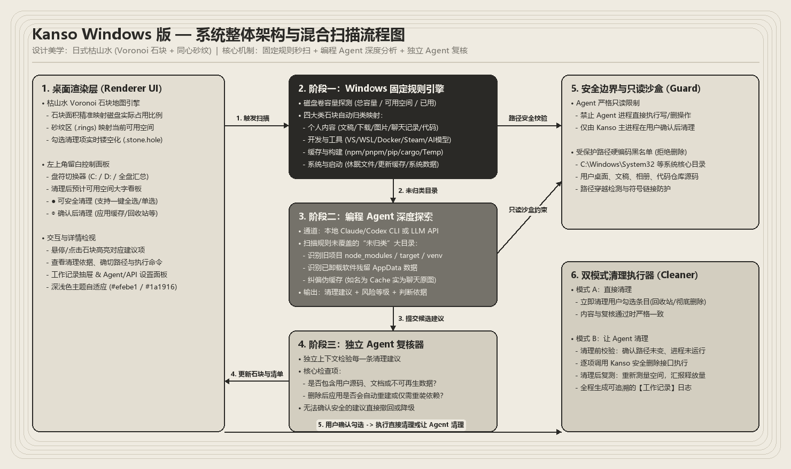
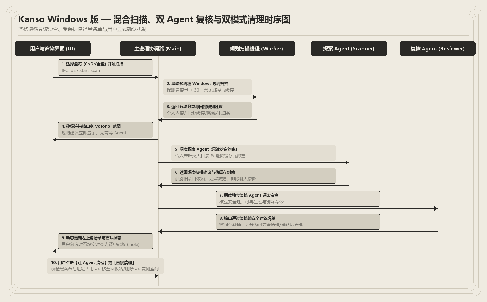

# Kanso Windows 版 (ClearDisk)

> 见微知著，还空间以留白。支持 Windows 多盘符的枯山水（Karesansui）磁盘空间可视化分析与混合 Agent 安全清理桌面工具。



## 核心特性

1. **枯山水（Karesansui）加权 Voronoi 庭院可视化**
   - 采用 Sutherland-Hodgman 半平面裁剪算法、内法线缩进（Inset）与二次贝塞尔曲线（`Q` 指令）生成温润有机的圆角石块。
   - 空闲空间与选中的待清理缓存石块自动切换为禅意同心砂纹（`.rings`），直观展现“清理后化为留白”的空间释放效果。
   - 原生支持浅色（和纸砂白 `#e9e5df`）与深色（玄武岩墨黑 `#161614`）双主题一键切换。

2. **100% 真实 Windows 磁盘深度扫描**
   - 支持全盘汇总（`ALL`）与单盘符（`C:`、`D:` 等）实时切换。
   - 内置 Windows 7 层深度真实文件测量引擎，精准扫描 `pnpm store`、`npm 缓存`、`Cargo 缓存`、`pip/uv 缓存`、`JetBrains 缓存`、`Playwright 内核缓存`、`~/.cache`、软件更新残留包（`*-updater`）以及各项目下的 `node_modules` / `target` / `.next` / `.venv`。
   - 支持在清理详情中一键点击 **“打开目录”**，直接在 Windows 资源管理器中定位核验真实文件夹。

3. **双 Agent 探索与独立安全复核**
   - **混合运行模式**：既支持零配置内置规则引擎秒扫，也支持自动检测本机 CLI Agent（如 `claude`、`codex`）或自定义 OpenAI 兼容 API（如本地 Ollama）进行深度探索。
   - **独立复核防误删**：所有清理建议均经过受保护目录硬编码黑名单（系统目录、微信/飞书聊天记录、个人文档桌面、SSH 密钥等）与伪缓存检测（自动拦截含个人原图或核心源码的目录）。

4. **安全清理执行（默认回收站兜底）**
   - 支持 **“让 Agent 清理”**（含修改时间戳复验 + `tasklist` 进程占用检测）与 **“直接清理”**。
   - 默认通过 PowerShell 调用 Windows 原生 `SendToRecycleBin` 移至系统回收站，亦可在设置中切换为直接永久删除。



## 快速开始

### 环境要求
- Windows 10 / Windows 11 (x64)
- Node.js >= 18

### 安装与运行

```powershell
# 1. 安装依赖
npm install

# 2. 编译并启动 Electron 桌面客户端
npm start
```

### 构建与测试

```powershell
# 编译 TypeScript 与前端静态资源
npm run build

# 运行 Vitest 单元测试套件
npm test
```

## 项目目录结构

```text
cleardisk/
├── docs/superpowers/          # 架构设计规范、实施计划与中文架构图资源
├── scripts/                   # 静态资源拷贝与 Electron 环境净化启动脚本
├── src/
│   ├── core/
│   │   ├── agent/             # 双 Agent 探索与独立安全复核协调器 (hybrid-agent.ts)
│   │   ├── cleaner/           # 清理执行引擎：时间戳复验、进程检查与回收站调用 (cleaner-engine.ts)
│   │   ├── safety/            # Windows 受保护路径黑名单与伪缓存检测 (safety-guard.ts)
│   │   └── scanner/           # Windows 真实磁盘深度扫描与缓存规则引擎 (windows-rules.ts)
│   ├── main/                  # Electron 主进程与 Preload 安全 IPC 桥接
│   ├── renderer/              # 枯山水加权 Voronoi 渲染器与前端交互界面
│   └── shared/                # 跨进程共享 TypeScript 类型定义
└── tests/                     # 5 大核心模块自动化测试套件
```
